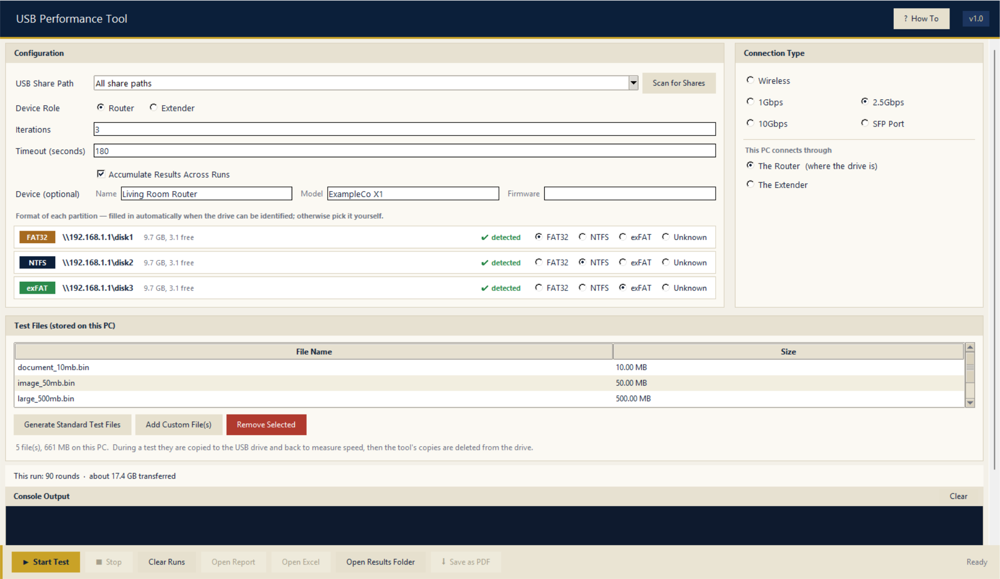
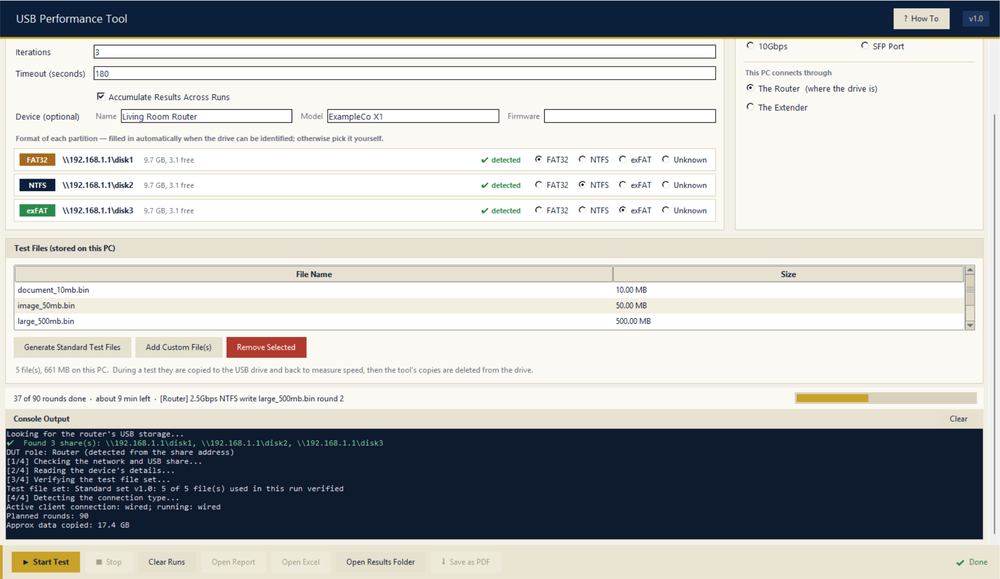
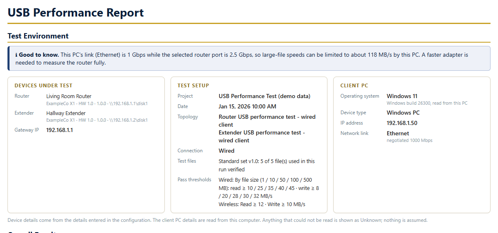
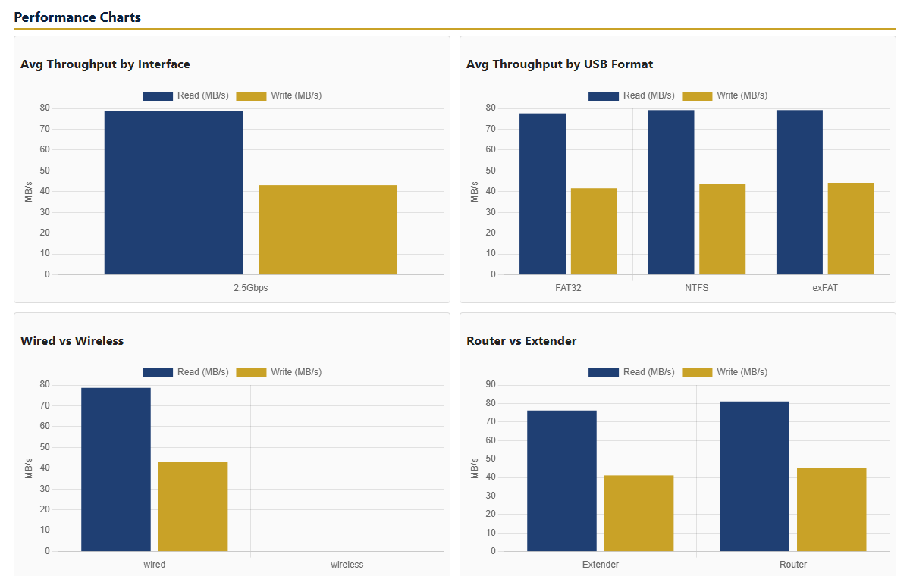
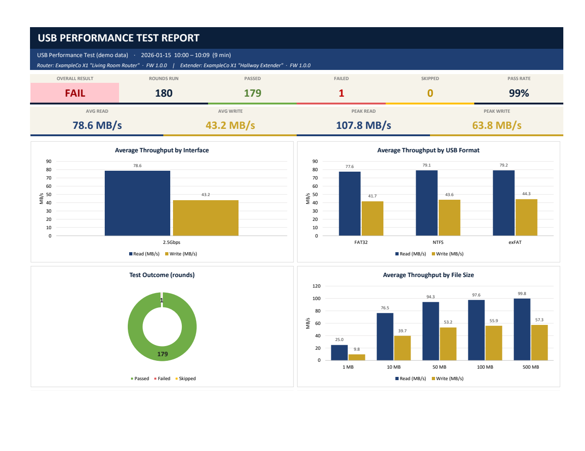

# USB Performance Tool

[](../../actions/workflows/tests.yml)

A Python/Tkinter desktop tool that **benchmarks the USB storage plugged into a router** (or any
SMB-shared USB drive): it copies a fixed, checksum-verified file set to and from the share,
times every transfer, judges each round against pass lines you control, and turns the results
into an **HTML report**, a formatted **Excel dashboard** and raw **CSV/JSON** — across wired
ports, Wi-Fi bands, partitions and file systems, for a main router and its extenders.



## What it does

| | |
|---|---|
| **Automates the whole matrix** | device role × connection × USB file system × file size × read/write × iterations, with averages, min/max and standard deviation |
| **Repeatable by design** | a fixed test-file set generated from a deterministic stream and verified against a SHA-256 manifest before every run |
| **Finds the drive for you** | looks for USB storage on the default gateway and on hosts that worked before; signs in if the router asks for a login |
| **Identifies the file system by measurement** | probes how the share stores timestamps to tell FAT32, exFAT and NTFS apart — the name Windows reports is often the same for every partition |
| **Judges fairly** | pass lines can be set **per file size** (small files are dominated by per-file overhead), and impossible speeds (cached copies) are rejected rather than passed |
| **Tells you when the PC is the bottleneck** | reads the PC adapter's negotiated link speed; a 100 Mbps link silently caps everything near 11 MB/s, so the tool warns about it |
| **Stops cleanly** | a Stop button ends the run, keeps what was measured, removes its temporary files from the drive and marks the rest as skipped |
| **Reports you can hand to someone** | HTML (charts, environment, failures), Excel (dashboard, filterable results, analysis tables) plus an empty template, and one-click PDF |
| **Wi-Fi band switching** | connects to each chosen band in turn and confirms it landed on the right one before measuring |

## Screenshots

**While a run is in progress** — progress bar, time left, and a console that always keeps a readable size:



**The HTML report** (from the synthetic demo data in `examples/`):




**The Excel dashboard:**



> Every number in the screenshots and in `examples/sample_report/` is **synthetic**, produced by
> `examples/make_demo_report.py`. Nothing in this repository was measured on, or describes, any
> particular product.

## Platform support

| | Windows 10/11 | macOS | Linux |
|---|:---:|:---:|:---:|
| Run a benchmark against a router's USB share | ✅ | ⚠️ not yet | ⚠️ not yet |
| Open the GUI, generate test files | ✅ | ✅ | ✅ |
| Generate the HTML / Excel / CSV reports (`examples/make_demo_report.py`) | ✅ | ✅ | ✅ |
| Run the test suite (a local folder stands in for the router) | ✅ | ✅ | ✅ |

The measurement engine talks to the router through Windows-only pieces: UNC paths (`\\router\share`),
the Native Wi-Fi API for band switching, and PowerShell/`netsh` for adapter and link-speed checks.
Porting it means mounting the share (`mount_smbfs` / `mount.cifs`) and replacing those probes — see
[docs/KNOWN_LIMITATIONS.md](docs/KNOWN_LIMITATIONS.md). CI runs the tests on Windows, macOS and Linux.

## Quick start

**Option 1 — the packaged app (Windows).** Download `USB_Performance_Tool.exe` from the
[Releases](../../releases) page, or build it yourself (see *Building* below). No Python needed.
Microsoft Edge or Chrome must be present for PDF export (Edge ships with Windows).

**Option 2 — from source** (Python 3.10+):

```powershell
cd src
pip install -r requirements.txt
copy test_config.example.json test_config.json   # optional: the app starts from the example anyway
python usb_gui.py
```

Want to see the output without any hardware? `python examples/make_demo_report.py` writes a full
sample report from synthetic data.

1. Plug a USB drive into your router and switch on its USB sharing.
2. Start the app — it scans for the share on launch. Pick **Generate Standard Test Files** the first time.
3. Choose **Wired** (pick the port speed you plugged into) or **Wireless** (tick the bands and enter each SSID/password).
4. Press **Start Test**. When it finishes, use **Open Report**, **Open Excel** or **Save as PDF**.

Prefer the command line? `python usb_test.py` runs the same engine with `test_config.json`.
Details are in [docs/USER_GUIDE.md](docs/USER_GUIDE.md) and [docs/CONFIGURATION.md](docs/CONFIGURATION.md).

## How a round is measured

```
 local test file ──write──▶ \\router\share\file ──(untimed: delete)
 \\router\share\_read_file ◀── staged copy ──(untimed) ──read──▶ local readback file
```

* **Write:** the local file is copied to the share and `fsync`ed; the clock covers only that copy.
* **Read:** a fresh copy is staged on the share (untimed, so the SMB client can't serve a cached repeat read), then copied back and timed.
* The tool's own files are deleted from the drive after every round, including when a round fails or is stopped.
* Each result row records the environment (role, device, firmware, topology, client, link speed, file system, file set version, verification status), so a result is traceable on its own.

## Engineering notes

The interesting problems this project had to solve:

* **Deterministic test data.** Files are generated block-by-block from a hash stream and verified against a manifest, so "the same test" means the same bytes — and a corrupted or edited file is flagged, not trusted.
* **File-system fingerprinting.** FAT32 stores last-access time as a date only, exFAT rounds the write time, NTFS keeps the full fraction. Stamping a probe file and reading the times back identifies the format even when the OS reports the same name for every partition. Verified against real FAT32/exFAT/NTFS volumes; inconclusive results are reported as such, never guessed.
* **A race over SMB.** A just-deleted file lingers in a "delete pending" state; re-creating the same name immediately fails with *Permission denied*. The tool waits for the name to become writable *before the clock starts*, so the measurement is unaffected. (Covered by a regression test that simulates the behaviour.)
* **Cooperative cancellation.** Stop is a flag file the engine polls between rounds and inside copies; the interrupt is a `BaseException` so the per-round error handler can't swallow it as a failed round.
* **Honest numbers.** A throughput above what any real link can carry is a cached or local copy — it is recorded as an error, not a pass. The PC adapter's negotiated speed is checked too, because a 100 Mbps link makes two very different drives look identical.
* **Faster start-up.** The independent pre-test checks (connection type, Wi-Fi, ping, file hashing) run in a thread pool while the rest proceeds; file hashing overlaps with everything else.
* **A windowed app that launches console tools.** Every helper process (`powershell`, `ping`, `netsh`) is started without a console window; otherwise each one flashed a terminal and stole keyboard focus.
* **GUI ⇄ worker split.** The packaged exe relaunches itself with `--run-test`; the GUI reads the worker's output over a UTF-8 pipe, including `\r` progress updates, and keeps all Tk calls on the main thread.
* **Adaptive layout.** The page scrolls on a 14-inch laptop (the console never shrinks below a readable size) and grows the console to use a 32-inch monitor.

## Project layout

```
src/
  usb_gui.py            Tkinter GUI; also the entry point of the packaged exe (--run-test, --selftest-*)
  usb_test.py           the engine: discovery, measurement, thresholds, reports, accumulation
  excel_report.py       the Excel workbook and empty template (xlsxwriter)
  browser_utils.py      launches Edge/Chrome for PDF export
  app_paths.py          locates data files next to the exe (not in PyInstaller's temp folder)
  generate_test_files.py   builds the deterministic test-file set
  file_set_manifest.json   SHA-256 of every file in the set
  test_config.example.json starting configuration
  tests/                hermetic unit and end-to-end tests
  scripts/build_exe.ps1 one-file build
examples/               make_demo_report.py + a generated sample report
docs/                   user guide, configuration reference, known limitations
```

## Testing

```
cd src
python -m unittest discover -s tests -v
```

The suite needs no router: a local folder stands in for the USB share and every network call is
replaced. It covers the threshold rules, role detection, UPnP parsing, the file-system probe,
each failure mode (unreachable share, full drive, impossible speed, timeout, below threshold),
the delete-pending race, Stop, a full two-run accumulation, and report generation.

## Building the single-file exe

```powershell
cd src
./scripts/build_exe.ps1
```

This produces `src/dist/USB_Performance_Tool.exe` (PyInstaller, windowed). Run
`USB_Performance_Tool.exe --selftest-paths`, `--selftest-excel` and `--selftest-browser` to
check a build.

## Known limitations

See [docs/KNOWN_LIMITATIONS.md](docs/KNOWN_LIMITATIONS.md). In short: benchmarking runs on Windows only; the wired port
is a label you choose (Windows can't see which port a cable is in); results are only as fast as the
PC's own network link; pass lines are yours to calibrate.

## License

MIT — see [LICENSE](LICENSE). Charts use [Chart.js](https://www.chartjs.org) (MIT), bundled as `chart.umd.min.js`.
